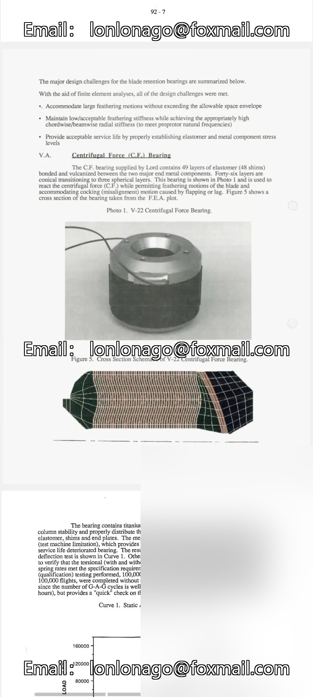
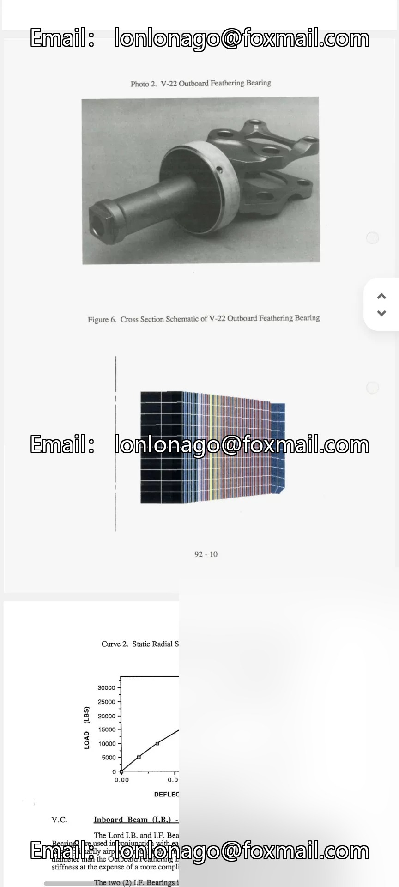
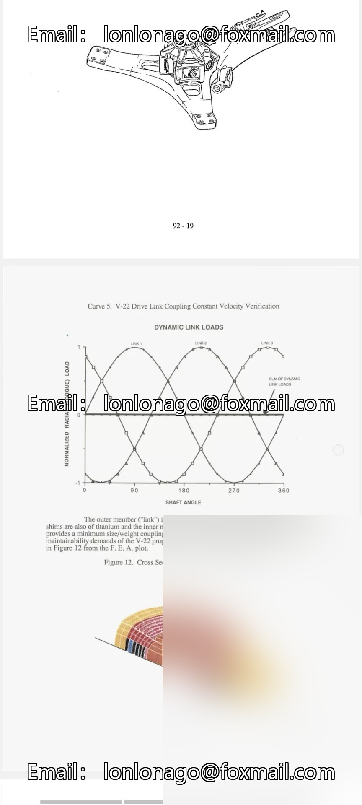

# "The Application of Elastomeri"

## Body

"The Application of Elastomeric Products on the V-22 Tiltrotor Aircraft" (The application of elastomeric products on the V-22 tiltrotor aircraft).

The V-22 "Osprey": A US-designed tilt-wing rotor aircraft that faces extremely complex aerodynamic, elastic, vibration control, and structural fatigue challenges during its R&D and testing flight stages.

Lord Corporation (Lord Company): A globally renowned supplier of aerospace shock reduction and elastic material technology, which has long provided critical solutions for the US military regarding shock reduction, vibration isolation, and elastic bearings.

Elastomeric Products (elastic products): In the aerospace field, it usually refers to elastic bearings, shock absorbers, flexible joints, etc., made of rubber-based composite materials. They can provide required flexibility while bearing large loads, and are key components for the blade system to achieve winging, oscillating, and pitch-change motion.
93022
Electronic data, no return after sale.

The article covers the application of elastomeric products on the V-22 Tiltrotor Aircraft, including its complex aerodynamic elastomer, vibration control and structural fatigue challenges, as well as the global aerospace damping and elastomer technology suppliers Lord Corporation and elastomeric products.

<!-- AI_ENRICHED -->

## Images

## Payment

Here is a pay link on Stripe ( https://buy.stripe.com/3cs8yP7sY87d0vu9AB ). Please contact me lonlonago@foxmail.com after funding $89, and I will send you a complete data files , thank you!

